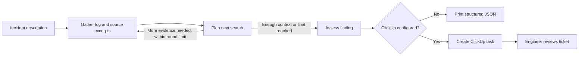

# Engineering Triage Agent

An independent Python / LangGraph portfolio prototype for investigating an application incident and turning evidence into a structured ticket.

**Status: demonstration scaffold.** This repository uses synthetic logs and a fictional example service. It contains no employer code, customer data, internal tickets, or production incident records. Dependencies and end-to-end behavior have not been verified; this is not a production deployment claim.

## The engineering problem

An error message is a starting point, not a diagnosis. A useful triage workflow should gather relevant log and code evidence, state uncertainty, and leave an engineer a concrete next step.



## What is implemented

- A LangGraph state machine with separate gathering, planning, and assessment nodes.
- A bounded investigation loop with structured LLM outputs via Pydantic.
- Read-only text searching of a supplied repository; analyzed code is not executed.
- Limits on candidate file count, individual file size, evidence length, and investigation rounds.
- A finding schema containing summary, severity, priority, evidence, and a suggested next step.
- Direct ClickUp REST API integration. **When both ClickUp variables are configured, running the CLI automatically creates a task.** Otherwise it prints a proposed ticket.

Human review occurs after ticket creation. This prototype's priority mapping is critical/high/medium/low to ClickUp urgent/high/normal/low; it does not implement a separate Warning default.

## Run with the synthetic example

Use Python 3.11+ and a project-local virtual environment. Python 3.14 was used to create the original local environment, but dependency compatibility has not been verified.

```powershell
py -m venv .venv
.\.venv\Scripts\Activate.ps1
python -m pip install -e .
Copy-Item .env.example .env
```

Set `OPENAI_API_KEY` in your local `.env`. Leave both ClickUp variables empty for console output. Then:

```powershell
triage-agent --incident "Checkout API database connection timeout" --log-file .\examples\sample.log --repo .\examples\demo_app
```

The fictional example contains an illustrative unit-conversion mistake for investigation. No actual service, customer, or measured operational impact is represented.

## Configuration

- `OPENAI_API_KEY`: required for model calls.
- `OPENAI_MODEL`: defaults to `gpt-4o-mini`.
- `CLICKUP_API_TOKEN`, `CLICKUP_LIST_ID`: optional; providing both enables automatic ticket creation.
- `MAX_INVESTIGATION_ROUNDS`: default `2`.
- `MAX_REPO_FILES`: default `250`.
- `MAX_FILE_BYTES`: default `200000`.

## Trade-offs and production gaps

Simple substring search makes this prototype easy to inspect, but can miss relevant code or collect unrelated lines. It reads a local log snapshot, not a live stream. Findings are hypotheses and need human verification.

There is no checkpoint persistence, deduplication, ClickUp retry policy, deployed service, production evaluation set, or permission-aware retrieval layer. The log reader limits selected output but currently reads the whole file into memory before selecting its tail. Path and symlink containment, secret redaction, prompt-injection defenses, and bounded execution time also need work before broader use.

**Data flow:** selected logs and source snippets are sent to the configured model provider. Use only synthetic or explicitly approved data. Never point this demo at confidential repositories or incidents without appropriate permission and data controls. Review the destination list before enabling ClickUp credentials.

No tests were run and no real model or ClickUp task was invoked while preparing this portfolio release.

